# 《明日方舟》塔露拉·雅特利亚斯（Talulah Artorius）人物设定与剧情全考据

> **档案级别**：罗德岛机密历史与人物卷宗 · 世界观导读手册  
> **适用读者**：无论是否完整阅读过《明日方舟》主线剧情（第 0–17 章，累计逾百万字文本），皆可通过本卷宗完整理解**塔露拉是谁、她经历了怎样的命运转折、她为何从一名最纯粹的理想主义者蜕变为毁灭城市的暴君，以及她如何在灰烬中重获新生**。  
> **文本与图像准则**：本卷宗引用的所有角色对白均**一字不差提取自《明日方舟》官方简体中文游戏剧本**（标注精确关卡代号）；所有配图均为**鹰角网络（Hypergryph）游戏客户端及 PRTS Wiki 官方原画与剧情插画（CG）**。

---

## 导读：一分钟读懂“塔露拉是谁？”

在《明日方舟》所构建的“泰拉（Terra）”大陆上，天灾留下的源石带来了现代工业文明，却也催生了不治之症——**矿石病（Oripathy）**。感染者在各国（尤其是军事帝国**乌萨斯**）遭受着残酷的隔离、奴役甚至肉体消灭。

**塔露拉·雅特利亚斯（Talulah Artorius）**，正是反抗这一不公命运的感染者组织——**“整合运动（Reunion Movement）”**的缔造者与初代精神领袖。

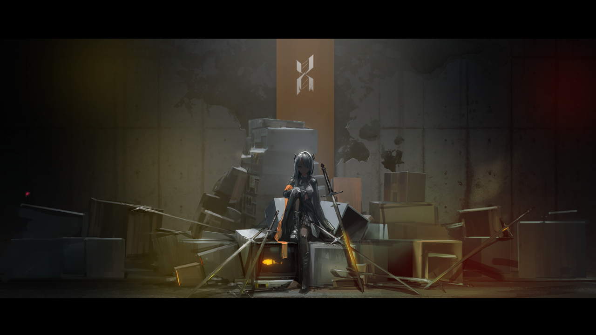

她的一生浓缩了泰拉大地最极致的戏剧冲突与哲学悲剧：
1. **高贵而破碎的血统**：她的父亲是流亡的维多利亚正统王室**红龙（德拉克）**后裔爱德华，母亲是炎国龙门执政者**魏彦吾**的亲妹妹，同母异父的妹妹则是龙门近卫局警司**陈晖洁**。
2. **恶魔养父的十年赌局**：9岁那年（1077年），阴谋家**科西切公爵（“不死的黑蛇”）**以炸毁半座龙门相要挟将她掳往乌萨斯，企图将她培养成继承自己冷血帝国意志的下一条“黑蛇”。18岁时（1086年），塔露拉为斩断科西切的政治利用，**亲手划开手臂嵌入源石碎片主动成为感染者**，并一剑刺死了科西切。但科西切在临死前与她立下了一个恶毒的赌约：**只要有一天她对这片大地上的普通人产生“仇恨”，她就会在绝望中认同科西切，成为新的“黑蛇”。**
3. **从冻原火炬到谷仓大火**：逃入乌萨斯西北冻原的塔露拉，在养父母伊万老爹夫妇与挚友**阿丽娜**的感召下，建立起保护受难同胞的早期整合运动，并感召了传奇军人**爱国者**与**霜星**父女。然而，在数年的冻原长征中，她接连遭遇了**被救感染者的背叛（卷耳村）**、**挚友阿丽娜被残忍虐杀**、**乌萨斯内卫当众揭穿其贵族养女身份引发内部猜忌**；最终，在一座三年没有纠察队踏足的普通村庄里，她发现村民仅仅因为冷漠与方便，就将手无寸铁的感染者同胞诱骗锁进空粮仓活活饿死并焚尸。这一刻，她对人性的信念彻底崩塌，吐出了那句违背誓言的**“我恨你们”**，一把火烧光了村庄——科西切（“不死的黑蛇”）自此夺取了她崩溃的意识。
4. **双龙斩蛇与戴镣赎罪**：在“黑蛇”主导下，塔露拉将整合运动异化为残暴的战争机器，攻陷切尔诺伯格并企图撞击龙门以挑起乌炎国战，导致霜星、浮士德、爱国者等昔日战友相继陨落。最终在核心城指挥塔上，妹妹**陈晖洁**与罗德岛领袖**阿米娅**联手斩断黑蛇的精神枷锁，唤醒了真正的塔露拉。清醒后的塔露拉**拒绝用自杀逃避罪责，也从未拿“被黑蛇附身”当作开脱的借口**。她在经历了罗德岛的幽禁后，被前近卫局警官**“九”**领导的新整合运动劫出，自愿戴上镣铐，以“罪人”的身份走遍维多利亚与乌萨斯边境，在泥泞的麦田与矿区中重燃真正属于底层人民的星火。

---

## 第一章：身世背景——红龙与真龙的苦果，龙门与乌萨斯的囚徒

### 1.1 基础人事档案卡

| 档案字段 | 官方设定数据（依据《大地巡旅》与《切城-龙门事件调查报告》） |
| :--- | :--- |
| **本名** | 塔露拉·雅特利亚斯（Talulah Artorius） |
| **称号 / 别称** | 小塔（陈、文月称）、公爵的女儿、“暴君”、“不死的黑蛇”、斗士塔露拉 |
| **种族** | 德拉克（Draco，父亲为德拉克，母亲为炎国“龙”族，外显特征随父系为银白发黑角的德拉克） |
| **出生日期** | 泰拉历 1068 年 1 月 9 日（切尔诺伯格事变 1096 年底时年满 28 岁） |
| **出生地** | 大炎 · 龙门（拥有维多利亚雅特利亚斯王室血统） |
| **身高** | 174 cm |
| **源石技艺** | 高阶热能/火焰操纵（具有极高温度的融毁与爆燃能力，无需法杖即可凭感染者体质直接施术） |
| **亲属关系** | • **生父**：爱德华·雅特利亚斯（已故，维多利亚流亡德拉克王裔） • **生母**：魏彦吾胞妹（已故，名字见载为延津/Yanjing） • **同母异父妹妹**：陈晖洁（前龙门近卫局特别督察组警司，现罗德岛合作干员） • **舅舅 / 舅母**：魏彦吾（龙门行政长官）、文月（东国公主） • **舅公 / 远亲**：大炎当朝天子（魏彦吾胞弟） • **养父（仇敌）**：科西切公爵（已故，乌萨斯斐迪亚旧贵族，“不死的黑蛇”） |

---

### 1.2 父辈往事：爱德华之死与赤霄剑的血痕（泰拉历 1055—1068）

要理解塔露拉一生悲剧的源头，必须回溯到她出生前龙门最高层的政治死局。

泰拉历 1055 年前后，维多利亚王室德拉克（红龙）一族在阿斯兰（狮子）王室与各大公爵的政治倾轧中式微。年仅二十岁的王室末裔**爱德华·雅特利亚斯**携带能够开启伦蒂尼姆王室秘宝“诸王之息”的钥匙流亡大炎，并在移动城市**龙门**结识了年轻气盛的**魏彦吾**与鼠王**林舸瑞**。

当时，龙门暗中受到乌萨斯阴谋家**科西切公爵**（“不死的黑蛇”当时的宿主）的渗透与操控。魏彦吾、爱德华与林舸瑞三人结为生死至交，合力发动政变，将科西切的势力连根拔起并驱逐出龙门。在击败科西切后的那个夜晚，三人在荒野上饮酒畅谈，那是龙门建城史上最意气风发的时刻（`END8-1`）。

然而，败走的科西切很快展开了恶毒的政治报复：
* **恋情与泄密**：爱德华与魏彦吾的亲妹妹彼此倾心，暗中成婚并怀上了孩子（即塔露拉）。科西切查明了爱德华隐匿的“维多利亚红龙王室末裔”身份，通过乌萨斯驻大炎使馆，将“魏彦吾私通维多利亚王室遗孤、甚至企图拥兵自重”的消息，同时泄露给了对魏彦吾心存忌惮的**大炎皇室（魏彦吾的弟弟、当朝真龙天子）**与**维多利亚伦蒂尼姆的情报黑手**。
* **二选一的死局（1067年）**：大炎朝廷派出禁军与“独角兽”密使向魏彦吾下达最后通牒——如果爱德华活着，不仅魏彦吾的妹妹和腹中胎儿必死无疑，整个龙门也将被大炎与维多利亚视为叛乱据点而灰飞烟灭。
* **挥泪斩义弟**：正如魏彦吾在 `END8-1` 无名冢前向陈晖洁坦白的那样：
  > **魏彦吾**：“他让我善妒的胞弟和伦蒂尼姆的阴影，知晓爱德华与我的妹妹……情投意合……我被迫在爱德华和我妹妹腹中的孩子里选一个。爱德华死后，我密不发丧十年，除了胞弟和科西切，无人知晓事实。” —— `END8-1`
  为了保住怀有塔露拉的妹妹和初创的龙门，魏彦吾挥起佩剑**“赤霄”**，亲手斩杀了毫无怨言赴死的结义兄弟爱德华。

1068年1月9日，遗腹子塔露拉降生。为了掩人耳目、保住塔露拉的性命，魏彦吾强迫妹妹改嫁给炎国陈氏贵族（后生下次女**陈晖洁**）。深爱爱德华的母亲一生都无法原谅亲手杀死爱人、又逼迫自己改嫁的兄长魏彦吾，对次女陈晖洁也态度冷漠，最终在无尽的悲愤与抑郁中含恨早逝。

---

### 1.3 龙门童年与“白昼夺女”（泰拉历 1068—1077）

在压抑的陈家大宅与冷漠的街坊流言中，身为混血德拉克的塔露拉因外貌异于炎国龙族、且生父不明，常被刻薄的龙门人私下称为“不祥的灾星”（`R8-1`）。但年幼的塔露拉性格却极为爽朗、正直且富于侠气：
* 她会在学校里为了保护被高年级学生欺负的年幼**诗怀雅（碧翠克斯）**而与一群孩子扭打得鼻青脸肿（`7-19`、`JT8-3`）。
* 她对同母异父的妹妹**陈晖洁**倾注了全部的温柔与爱护，陪妹妹练拳、读书、在晖洁掉进池塘大哭时把她抱上岸。在年幼的陈晖洁心中，勇敢耀眼的姐姐“小塔”就是她的精神支柱与人生榜样。

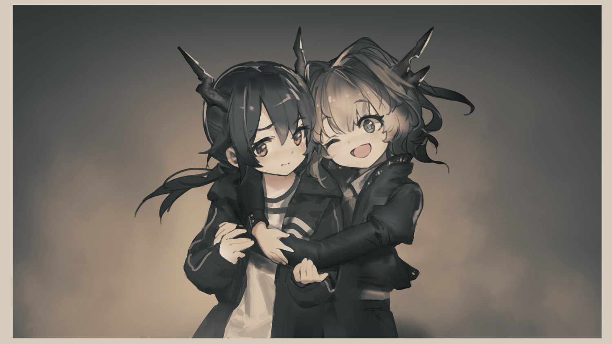
*▲ 官方剧情 CG `Avg_8_42`：童年时期的塔露拉（左）与陈晖洁（右）。这张照片一直被陈晖洁珍藏在近卫局办公室内。*

然而，泰拉历 **1077年**（塔露拉 9 岁），潜伏十年的科西切公爵再度潜入龙门。他利用莱塔尼亚双子女皇登基初期的外交混乱潜伏进城，绑架了年幼的塔露拉，并在她手腕上锁上了与龙门半数城区源石炸弹联动的引爆铐环（`7-20`）。

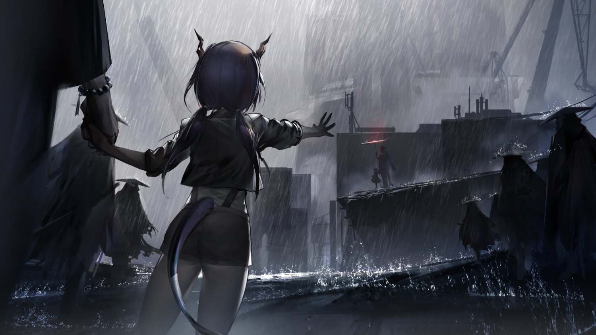
*▲ 官方剧情 CG `Avg_7_23`：1077年龙门，科西切以炸毁半座龙门要挟魏彦吾，带走年仅9岁的塔露拉，年幼的陈晖洁只能在雨中哭喊“小塔”。*

在 `7-20` 的回忆中，科西切当着重伤的魏彦吾与年幼的陈晖洁的面，逼迫魏彦吾做出第二次残酷的选择：
> **科西切**：“我当然可以把她还给你……但她身上的铐环会引爆龙门半数城区。……选吧。杀掉我抢回侄女，并因此毁掉这座城市；又或者允许我们平安离开。” —— `7-20`

为了不让龙门化为火海、不让舅舅魏彦吾与妹妹陈晖洁丧命，年仅九岁的塔露拉甚至以自尽威胁魏彦吾不要追击，独自一人跟随杀死生父的幕后真凶科西切踏上了前往乌萨斯的寒冬之路。

---

## 第二章：人物关系全图谱——血脉、诅咒、战友与镜像

塔露拉的人物关系网横跨**大炎龙门、乌萨斯帝国、整合运动、罗德岛、维多利亚深池**五大势力。她与每一个核心人物的互动，都直接推动了她从“贵族养女 $\rightarrow$ 冻原斗士 $\rightarrow$ 黑蛇暴君 $\rightarrow$ 戴镣行者”的四次人格蜕变。

### 2.1 塔露拉核心人物关系拓扑图

```mermaid
flowchart TB
    subgraph LUNGMEN["【一、龙门血脉与童年】"]
        EDWARD["爱德华·雅特利亚斯<br/>(生父 · 维多利亚红龙王裔)"]
        MOTHER["魏彦吾胞妹<br/>(生母 · 含恨而终)"]
        WEI["魏彦吾<br/>(亲舅舅 · 龙门执政者)"]
        CHEN["陈晖洁<br/>(同母异父妹妹 · 赤霄传人)"]
    end

    subgraph SNAKE["【二、黑蛇诅咒与帝国阴影】"]
        KASH["科西切公爵<br/>(养父 · “不死的黑蛇”初代宿主)"]
        KOSH["卡谢娜 / 菲奥莉特<br/>(黑蛇新容器 · 骏鹰大学讲师)"]
        BLADE["乌萨斯“皇帝的利刃”<br/>(帝国暗杀部队 · 揭穿身世者)"]
    end

    subgraph TUNDRA["【三、早期整合运动与冻原羁绊】"]
        IVAN["伊万老爹与老妇<br/>(冻原收留者 · 割腕替死)"]
        ALINA["阿丽娜 (Alina)<br/>(埃拉菲亚乡村教师 · 精神锚点)"]
        PATRIOT["爱国者 (博卓卡斯替)<br/>(温迪戈游击大尉 · 军事支柱)"]
        FROST["霜星 (叶莲娜)<br/>(雪怪小队队长 · 生死知己)"]
        FAUST_MEPH["浮士德(萨沙) & 梅菲斯特(伊诺)<br/>(塔露拉救下的感染者少年)"]
        W_MERC["W (萨卡兹雇佣兵首领)<br/>(暗中观察者 · 协助制动核心城)"]
    end

    subgraph REDEEM["【四、救赎、审判与德拉克镜像】"]
        AMIYA["阿米娅 (罗德岛领袖)<br/>(魔王继承人 · 斩断黑蛇幻境)"]
        NINE["“九” (Nine)<br/>(新整合运动领袖 · 持链看守者)"]
        GUARD["Guard<br/>(背叛罗德岛劫狱 · 伦蒂尼姆牺牲)"]
        EBLANA["爱布拉娜 (深池领袖)<br/>(同族红龙镜像 · 紫火野心家)"]
    end

    EDWARD & MOTHER -->|生育| TALULAH(("【塔露拉】<br/>Talulah Artorius"))
    WEI -->|挥赤霄忍痛斩杀| EDWARD
    WEI -->|愧疚半生 / 1077被迫放手| TALULAH
    CHEN <-->|手足至亲 / 拔剑唤醒与承诺审判| TALULAH

    KASH -->|1077劫持抚养 / 1086被塔露拉刺杀并种下赌约| TALULAH
    TALULAH -->|1098于大学教室直面并震慑| KOSH
    BLADE -->|R8-11当众揭穿贵族身份瓦解信任| TALULAH

    IVAN -->|R8-3割腕顶罪唤醒其公义之心| TALULAH
    ALINA <-->|R8-6树下谈心 / R8-9惨死成为悲剧拐点| TALULAH
    PATRIOT <-->|R8-5合流与担保 / 第7章被黑蛇设局逼死| TALULAH
    FROST <-->|R8-5冰雪切磋结为挚友 / 第6章陨落| TALULAH
    TALULAH -->|R8-6救下抚养 / 切城沦为悲剧弃子| FAUST_MEPH
    W_MERC -->|JT8-3接过真秘钥停下核心城| TALULAH

    AMIYA -->|JT8-2/3共鸣记忆与陈联手斩断黑蛇| TALULAH
    NINE -->|9-19劫狱并为塔露拉戴上赎罪镣铐| TALULAH
    GUARD -->|9-19救出塔露拉 / 13-16践行信念战死| TALULAH
    EBLANA <-->|13-22芦苇荡双龙对决 / 被塔露拉斥为虚伪暴君| TALULAH
```

---

### 2.2 四大核心人物圈层深度剖析

#### （一）精神导师与毁灭之源：科西切公爵（“不死的黑蛇”）与阿丽娜（Alina）
塔露拉的前半生，本质上是**科西切种下的“仇恨毒刺”**与**阿丽娜缝补的“人性微光”**在她灵魂深处展开的一场长达十年的拔河。

* **科西切公爵（Duke Kashchey）—— 完美复刻自身的精神寄生者**：
  * 科西切从未用铁链囚禁塔露拉，他甚至允许塔露拉修订领地法令去保护感染者（`R8-5`），然后冷眼旁观市民如何因自身利益受损而更加疯狂地欺凌感染者。
  * 他深知塔露拉拥有极高的道德洁癖与共情能力——**越是深爱人类、越是相信人类本善的理想主义者，在直面底层民众自发的愚昧与恶毒时，所产生的幻灭与仇恨就越彻底**。他将自己毕生的政治权谋、军事统御术与虚无主义历史观倾囊相授，只等塔露拉被现实击垮的那一刻，顺理成章地将她变成自己的替身。
* **阿丽娜（Alina）—— 唯一看穿黑蛇诡计的凡人教师**：
  * 身为普通的埃拉菲亚乡村教师，阿丽娜没有任何毁天灭地的源石技艺，却拥有连科西切都未曾预料到的通透智慧。
  * 在 `R8-6` 树下缝补霜星斗篷的经典对话中，阿丽娜一针见血地指出了塔露拉与爱国者共同的弱点：**“科西切要你是圣人，可人都会犯错。摔倒以后要爬起来。但如果他不允许你摔倒……你就只能小心翼翼一点。”**
  * 她告诉塔露拉，对抗黑蛇的方法不是逼自己做一个永不犯错的神，而是关注“看得见摸得着的事情”——孩子们读书的声音、烤蔬菜的热气、手中的针线。只要阿丽娜还活着，塔露拉心中的黑火就永远无法越雷池一步；因此，阿丽娜在 `R8-9` 的惨死，直接抽走了塔露拉灵魂深处唯一的防波堤。

#### （二）北原游击同盟：爱国者（博卓卡斯替）与霜星（叶莲娜）
* **爱国者（Patriot）—— 从严厉审视者到悲壮托孤者**：
  * 初见时（`R8-6`），历经百年战火的老温迪戈一眼看出年轻的塔露拉“从没因事实而失望，一直只是在陈托某种假大空的学说”，严词拒绝随她盲目南下。
  * 然而，在四年并肩作战中，塔露拉在卷耳村感染者背叛时依然坚守底线（`R8-8`/`EG-1`），赢得了爱国者发自肺腑的敬重。当“皇帝的利刃”在 `R8-11` 当众揭穿塔露拉是科西切养女、企图瓦解整合运动时，爱国者毅然扶起塔露拉，向内卫与全军宣告：**“现在的首领不是我。是她。……只要你的品性不让我失望，我会支持你直到最后一刻。”**
  * 正因如此，当塔露拉被黑蛇夺舍后，爱国者成了最后一个看穿她已不再是塔露拉、却为了维护感染者旗帜不倒而痛苦隐忍的悲剧英雄，直至在切尔诺伯格核心城与罗德岛死战到底（第7章）。
* **霜星（FrostNova）—— 冰与火的生死知己**：
  * 从 `R8-5` 雪原上“如果我能融化你的冰，你会不会愿意听我说两句”的不打不相识，到夜晚一起守在熟睡的萨沙（浮士德）与伊诺（梅菲斯特）身旁轻声交谈（`END8-1`），霜星是塔露拉在战士群体中最亲密的挚友。
  * 当整合运动在切城滑向深渊时，霜星怀着与昔日塔露拉完全相同的理想，在龙门与罗德岛完成最后的决战后化作寒霜消逝（第6章）。她的名字后来被阿米娅命名了在乌萨斯廉价普及的矿石病外用特效霜（`END8-1`）。

#### （三）四大镜像人物对照矩阵（The Four Mirrors Foil Matrix）

| 镜像角色 | 与塔露拉的共通点 | 核心道路分歧与哲学对照 | 剧情高光交锋节点 |
| :--- | :--- | :--- | :--- |
| **阿丽娜** *(Alina)* | 共同创立早期整合运动，同为渴望改变感染者命运的先行者 | **【针线 vs. 刀剑 / 日常唯物 vs. 救世宏愿】** 阿丽娜不相信看不见的“命运”，只相信从教孩子认字、辨认蘑菇开始的漫长启蒙；塔露拉则急于在自己短暂的生命里为所有人夺回公平。 | `R8-6` 树下谈心 `R8-9` 雪原背负与临终遗言 |
| **陈晖洁** *(Ch'en)* | 同母异父的亲姐妹，共同承受1077年龙门分离之痛与后天的矿石病感染 | **【体制律法改革 vs. 旷野武装革命】** 陈晖洁试图在龙门近卫局的律法框架内寻求公正，在认清城市局限后脱下警服，用赤霄斩断姐姐的黑蛇梦魇，并发誓建立一个能“公正审判所有人”的地方。 | `JT8-2` / `JT8-3` 双龙决战与徒手互搏 `14-23` 伦蒂尼姆街头重逢 |
| **阿米娅** *(Amiya)* | 年轻的感染者组织领袖，体内均背负着足以吞噬心智的古老黑暗遗产（魔王之怒 vs. 黑蛇诅咒） | **【分担重负的同行者 vs. 孤身硬扛的殉道者】** 塔露拉在阿丽娜死后对所有人隐瞒了自己的动摇，最终在孤独中崩溃；阿米娅则在博士、凯尔希、迷迭香与陈的共同支撑下，将魔王的愤怒转化为守护生命的手术刀。 | `JT8-2` 近卫升变拔出“怒目青火” `JT8-3` 灵魂共鸣唤醒塔露拉 |
| **爱布拉娜** *(Eblana)* | 维多利亚雅特利亚斯家族仅存的两支纯血红龙（德拉克）王裔，均操弄火焰并领导被压迫者的反抗军 | **【奴役死者的紫火暴君 vs. 庇护生者的橙红薪火】** 爱布拉娜视塔拉平民的生命为“易燃的燃料”，用死灵紫火驱策亡骸以成就王权；洗尽铅华的塔露拉则拒绝王冠，斥责爱布拉娜不过是另一条“虚伪的暴君”。 | `12-21` 否定“历史胜利者” `13-22` 伦蒂尼姆城外芦苇荡双龙交锋 |

---

## 第三章：性格与动机深度剖析——她为什么会走到这一步？

对于没有完整读过剧情的读者而言，最核心的疑问莫过于：**一个为了保护不相识的感染者敢于直面帝国军队、为了不被养父利用敢于往自己手臂里塞源石的崇高少女，为什么会在短短几年后变成下令屠杀平民、把昔日战友一个个送去垫背的冷血暴君？**

官方剧本通过极为严密的心理学与社会学铺垫，给出了一个环环相扣的解答：**塔露拉的堕落，绝非简单的“魔法洗脑”，而是“圣徒式人格的内在裂痕”在遭遇“乌萨斯结构性暴政与底层人性平庸之恶的三重绝境”后，引发的一场全面信仰崩塌。**

---

### 3.1 塔露拉的性格底色：高洁的圣徒情结与致命的“孤高盲区”

在冻原建军时期，塔露拉展现出令人震撼的人格魅力：她乐观、果敢、没有丝毫贵族架子，能与农民同耕苔麦，能为素昧平生的饥饿孩童（萨沙与伊诺）折枝生火（`R8-6`）。

然而，在这份耀眼的光芒背后，潜藏着三个致命的心理隐患：

1. **有条件的乐观主义（“因为他们值得”）**：
   在 `R8-5` 刺杀科西切后的回忆中，阿丽娜曾敏锐地问过塔露拉一个问题：
   > **阿丽娜**：“塔露拉，你是为了有所得才去付出的吗？”  
   > **塔露拉**：“我认为我们的所作所为一定会有好的结果，原因也很简单。**因为他们配得上那个结果。因为这片大地上的生灵值得那个结果。**” —— `R8-5`
   
   注意这句话的潜台词：早期的塔露拉之所以相信“绝大多数人只要有机会都会选择做好人”（`R8-5`），是因为她预设了受苦的大众在道德上是无辜且崇高的。一旦残酷的现实证明大众在没有逼迫时也会作恶，这种建立在“道德完美假设”上的信念就会瞬间地动山摇。

2. **科西切强加的“完人/圣人”枷锁**：
   科西切从小向她灌输“万中无一的顶点”与“完人”的标准（`R8-5`）。这使得塔露拉在成为整合运动领袖后，习惯性地把所有人的生死、口粮、路线乃至道德纯洁性全部扛在自己一个人肩上，**绝不允许自己犯错，也绝不在战士面前流露出一丝软弱**。

3. **拒绝向战友倾诉的孤独**：
   当爱国者质疑她的战略（`R8-6`）、当队伍缺粮少药时，塔露拉从不向霜星或爱国者分担内心的恐惧，唯一的倾诉对象只有营地后方的阿丽娜。正如阿丽娜所担心的那样——一旦失去了阿丽娜，塔露拉就彻底变成了一座拒绝与任何人沟通的孤岛。

---

### 3.2 深度专题：“不死的黑蛇”究竟是什么？（四层剖析）

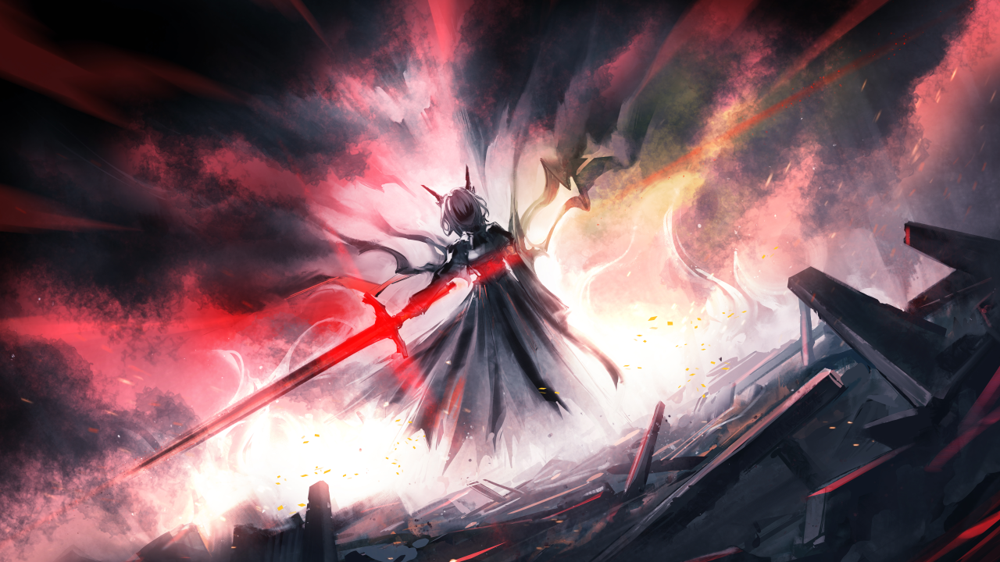
*▲ 官方剧情 CG `Avg_8_10`：“不死的黑蛇”在切尔诺伯格指挥塔显现。盘踞在塔露拉身后的巨蛇，既是科西切的精神烙印，也是乌萨斯千年军国主义意志的具象化。*

在《明日方舟》社区中，关于“不死的黑蛇（The Deathless Black Snake）”的讨论最为深入。根据 `R8-5`、`JT8-2`、`JT8-3`、`END8-1` 与 `10-19` 的官方文本，我们可以从四个层面彻底厘清它的本质：

| 解析维度 | 官方文本依据 | 核心机制阐述 |
| :--- | :--- | :--- |
| **第一层：源石技艺机制** *（极其微弱的引导术）* | `R8-5` 科西切原话： “我的法术十分弱小，教授你的这一切也都是构成这个法术的基础。**这个法术，在你否定我的时候，不会体现任何作用。**” | 黑蛇的源石技艺**不是强制洗脑或提线木偶式的肉体操控**。塔露拉本人精通破解精神系法术，只要她的信念坚定，科西切的法术对她就是零作用。 |
| **第二层：心理防御铠甲** *（以“恨意”触发的赌约）* | `R8-5` 科西切原话： “在你接下来的一生里，你只要对你所坚持的这一切产生怀疑，你只要对你声称的这些你的同胞……**产生一点恨意**，你就会立即履行我们之间的赌约。……我向你提供了一副铠甲，一种武器，一个自我。” | 当塔露拉在谷仓惨案中因极度失望而产生“我恨你们”的念头时，她无法承受自己亲手屠杀平民的道德崩溃。为了不让自己发疯，她的大脑潜意识地穿上了科西切提前为她准备好的“冷酷统治者铠甲”——用科西切的记忆与人格接管了身体。 |
| **第三层：历史意识形态** *（乌萨斯的千年幽灵）* | `10-19` 卡谢娜原话： “乌萨斯走过了自己的第一个千年——而我会令它走向第二个，第三个。这才是黑蛇存在的意义。**黑蛇不死，不是因为我有着自我存续的意志，而是因为乌萨斯必须活下去。**” | “不死的黑蛇”超越了科西切个人，它是乌萨斯帝国建立在征服、恐惧、等级压迫与社会达尔文主义之上的**国家意志结晶**。只要乌萨斯的社会土壤不变，哪怕科西切死了，它也会在塔露拉、卡谢娜或下一个野心家身上复活。 |
| **第四层：道德主体责任** *（塔露拉本人的承认）* | `JT8-3` 阿米娅原话： “**如果她完完全全不愿意的话，那些事……你是做不了的。属于你的那些想法……无论是不是被扭曲过，那都确实来自……塔露拉本人。**” | 这正是《明日方舟》剧本最高明之处：它没有用“被附身”把塔露拉洗白成无辜白莲花。黑蛇所做的一切，本质上是塔露拉内心深处“既然这片大地如此腐朽，不如将一切付之一炬”的绝望冲动的极端放大。 |

---

### 3.3 信仰崩塌的完整因果链：压垮骆驼的三记重锤

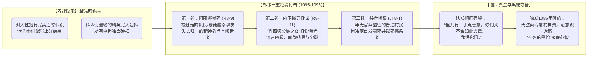

让我们结合官方原版剧本，复盘这三记重锤是如何一步步击穿塔露拉的心理防线的：

1. **第一锤（抽走道德刹车）：阿丽娜之死（`R8-9`）**
   严冬断粮，几名被驱逐的感染者或暴徒残忍杀害了外出换粮的阿丽娜。塔露拉背着流血不止的阿丽娜在无尽的雪原上狂奔，阿丽娜在咽气前拼尽全力告诫她：**“你可以厌恶一件事……他们做的事情，你可以痛恨……可你不准去恨……一个人。”** 然而，极度的创伤让塔露拉出现了应激性失忆（“塔露拉不记得之后发生了什么。塔露拉什么都不记得”）。从此，每当她在黑夜里看到烛火，都会忍不住伸手掐灭（`R8-11`）。

2. **第二锤（瓦解组织信任）：“皇帝的利刃”诛心之计（`R8-11`）**
   乌萨斯内卫没有强杀塔露拉，而是用了一招更狠毒的阳谋——当着几十名普通感染者战士的面，恭敬地称呼她为**“公爵的女儿”、“科西切之女”**，并故意留下一句：“你父亲给我们的承诺，全都就此作废。”
   尽管爱国者与霜星坚定地站在塔露拉身前，但底层感染者看她的眼神已经彻底变了（`R8-11` 结尾：“塔露拉……你有什么阴谋？”）。塔露拉在 `JT8-1` 中苦涩地感慨：**“流言出现以后，就没有人是清白的了。”** 她拼尽全力保护同胞，同胞却开始怀疑她是贵族派来的内奸。

3. **第三锤（击碎人性幻想）：粮仓门上的抓痕（`JT8-1`）**
   这是全剧最令人窒息的一幕。塔露拉独自一人去一座小村庄寻找失踪的感染者同伴，却在空粮仓的大门内侧看到了**深深的指甲抓痕与沉积的源石碎屑**。
   村民们笑脸相迎地撒谎说感染者抢了粮食跑了；被拆穿后，又辩解说自己也没粮、是被逼无奈。但塔露拉查明了真相——
   > **塔露拉**：“感染者纠察官已经三年没来过你们的村子。拥有这几个聚落的贵族早在大叛乱中丧生，局势混乱不堪，你们的村子已经多年无人管理。**就在这样的情况下……你们……自然而然地……害死了和你们毫无利害关系的人。只要你们心存一点点善意……你们一样可以放走他们。整个村子听着他们的哀嚎无动于衷，直到他们死去。但凡还有一丁点善意存在，你们就不会如此恶毒。我恨你们。**” —— `JT8-1`
   
   之前所有的恶行（纠察队杀人、村民告密），塔露拉都可以替他们找借口说“是乌萨斯的暴政逼得他们没得选”（`R8-5`）。可在这座三年没有任何政权监管的无政府村庄里，普通的农民仅仅因为“把感染者骗进空粮仓锁死饿死最方便”，就冷漠地听着无辜者抓挠木门哀嚎至死，还把尸体混着废源石一起烧成灰！
   这一刻，科西切十年前的话语在她脑海中轰然应验（“他们爱好施暴，四处残杀，自虐、惶恐又自私”）。塔露拉挥剑燃起冲天大火，将整座村庄连同自己前半生的理想一同烧成了灰烬。

---

## 第四章：游戏剧情中的完整经历（六幕编年史）

为了方便完全没有接触过游戏或仅了解片段的读者顺畅阅读，以下将打乱在各章节回忆中的碎片，按**严格的事件先后顺序**还原为完整的六幕史诗。

---

### 第一幕：龙门暖阳与乌萨斯宫廷（泰拉历 1068—1086）
> **对应关卡**：`5-10`、`7-19`、`7-20`、`M8-2`、`R8-5（行动后）`、`END8-1`

1. **龙门的孤女与长姐（1068–1077）**：
   塔露拉作为爱德华的遗腹子在龙门长大，与同母异父的妹妹陈晖洁情同手足。1077年，9岁的塔露拉在科西切的炸弹威胁下，为保全龙门与舅舅魏彦吾，毅然随科西切前往乌萨斯。
2. **公爵领的“完美继承人”（1077–1086）**：
   在乌萨斯科西切公爵领的九年里，科西切将她作为未来的公爵培养。塔露拉表面上学习贵族礼仪、军事与源石技艺，出席舍瓦塔会议与募捐晚宴（`7-3`、`R8-5`），暗中却不断修改政策试图保护领地内的感染者，并与科西切冷血的统治哲学发生激烈冲突。
3. **自嵌源石与刺杀养父（1086年，18岁）**：
   * 1086年初，为了彻底断绝科西切将自己作为政治继承人或贵族联姻工具的企图，塔露拉从矿场弄来一小块源石矿材碎片，**亲手划开自己的手臂将其嵌进血肉**，主动感染了矿石病。
   * 半年后，塔露拉在执行除掉异己安东尼奥少校的任务时，故意放走了少校年幼的儿子并烧毁机密档案。回到城堡王座厅后，她向科西切亮出自己感染者的身份，痛斥科西切在自己生父之死中的阴谋以及对乌萨斯领民虚伪的剥削。
   * 科西切非但没有动怒，反而微笑着向她传授了“最后一课”，立下了关于“人性与仇恨”的灵魂赌约，随后放弃抵抗，任由塔露拉一剑刺穿自己的胸膛（`R8-5 行动后`）。

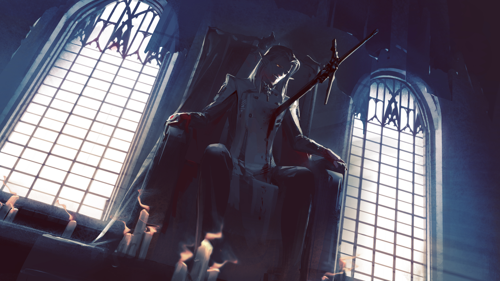
*▲ 官方剧情 CG `Avg_8_1`（纪念插画名《垂死的黑蛇》）：1086年，18岁的塔露拉一剑刺穿养父科西切公爵的胸膛，科西切在弥留之际将“不死的黑蛇”精神赌约种入她的脑海。*

---

### 第二幕：冻原栖身与芦苇荡之火（泰拉历 1087—1089）
> **对应关卡**：`R8-1`、`R8-3`、`R8-4`

1. **伊万老夫妇的收留（1087–1089）**：
   刺杀科西切后，精神恍惚、浑身是血的塔露拉一路向西北逃亡，最终倒在冻原深处一座小村庄的木屋门前。失去子女的老农**伊万·伊贾斯拉夫**与老伴收留了她，把她当亲生女儿一样疼爱，替她隐瞒了感染者身份与那把贵族长剑。在这里，塔露拉度过了人生中最温暖平静的两年，并与同村聪慧温柔的埃拉菲亚姑娘**阿丽娜**结为挚友（`R8-1`）。
2. **例行检查与老爹割腕顶罪（1089年12月14日—次年1月13日）**：
   * 12月14日，乌萨斯**感染者纠察队**进村勒索例行检查，打伤了交不起钱的伊万老爹。愤怒的塔露拉出手击退了纠察队员（`R8-1`）。
   * 次年1月13日，大批纠察队封锁村庄逐户搜捕袭击者与感染者。塔露拉原本留下维多利亚金币准备独自引开追兵，但村里有人告密称村中藏有感染者。
   * 为了保住年轻的塔露拉和阿丽娜，早年在矿场染病却一直隐瞒的伊万老爹主动找上纠察队，当众用刀割开手腕释放出雾状源石技艺，高喊**“我是货真价实的感染者！”**，当场被纠察队杀害（`R8-3`）。
3. **焚灭纠察队与创立互助组（1089年初）**：
   赶来的塔露拉目睹老爹惨死，怒火冲天，挥剑将整支纠察队烧成焦炭，随后带着同样身为感染者的阿丽娜逃离村庄。一个月后（`R8-4`），塔露拉在冻原上救下一批被纠察队屠杀的感染者流民，正式举起了反抗与互助的火炬。

---

### 第三幕：整合运动的黄金年代与冻原长征（泰拉历 1091—1095）
> **对应关卡**：`R8-5`、`R8-6`、`R8-8`、`EG-1`

1. **冰雪对决霜星与游击队合流（1091年，`R8-5`）**：
   经过两年发展，塔露拉的感染者队伍急需真正的军事力量庇护。她主动寻访威震北原的**雪怪小队**与**博卓卡斯替（爱国者）游击队**。在与雪怪队长**霜星（叶莲娜）**的一对一交锋中，塔露拉以烈焰融化寒冰战胜霜星，并向她伸出平等握手的右手。

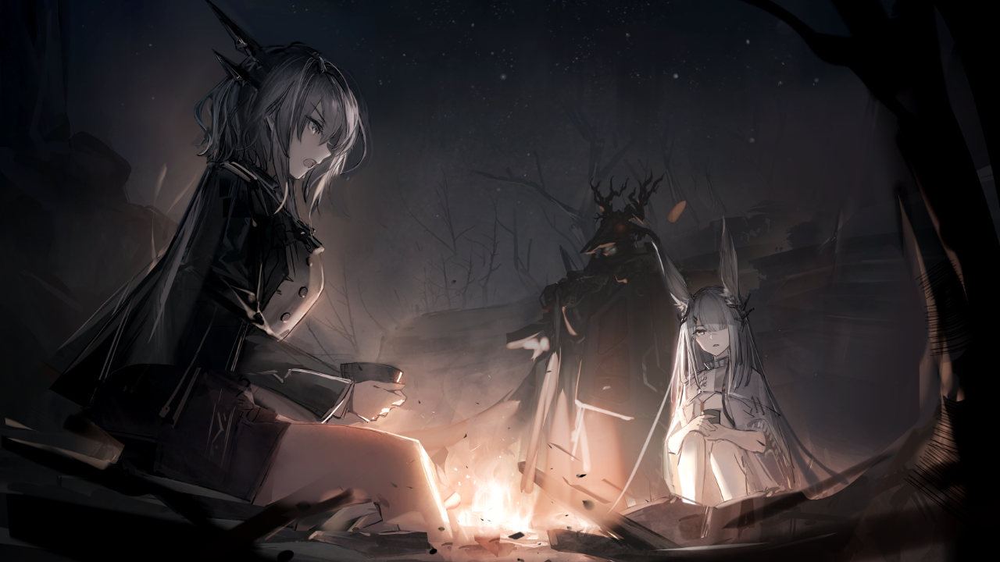
*▲ 官方剧情 CG `Avg_8_3`：塔露拉向霜星与高如山岳的温迪戈大尉“爱国者”阐述团结全乌萨斯感染者的理想，促成早期整合运动与游击队的历史性合流。*

2. **收留萨沙与伊诺，树下夜话（`R8-6`）**：
   * 在攻打军驻矿场后，尽管爱国者严厉批评塔露拉的南下设想是“加速所有人的死亡”，塔露拉依然没有气馁。她在森林里发现了两个饿得瑟瑟发抖的流浪感染者孩童——**萨沙（后来的浮士德）**与**伊诺（后来的梅菲斯特）**，用树枝点起温暖的火星救下了他们，交由阿丽娜抚养读书。
   * 当晚，塔露拉带着被自己训练时烧坏的霜星斗篷找阿丽娜缝补。在树下，两人进行了关于“感染者与普通人”、“刀剑与针线”、“自我战争”的深刻对话。

*▲ 官方剧情 CG `Avg_8_4`：冻原宁静的夜晚，阿丽娜为塔露拉缝补霜星的斗篷，塔露拉安心地靠在阿丽娜肩头。这是塔露拉一生中最温柔的时刻。*

*▲ 官方剧情 CG `Avg_8_21`：早期整合运动的黄金岁月——爱国者、塔露拉、霜星、年幼的浮士德与梅菲斯特在冬日篝火旁共享短暂的安宁。*

3. **卷耳村背叛与坚守底线（1095年，`R8-8` / `EG-1`）**：
   南下途中，一部分厌倦流亡的感染者在塔露拉的允许下脱离队伍，占据了一座废弃的移动城市地块，却转头向乌萨斯正规军告密出卖了整合运动，把整合运动当作吸引火力的诱饵。即便面对如此卑劣的背叛，塔露拉依然制止了盾卫挂死逃兵的冲动，坚持给每个人自由选择的权利。爱国者由此在暗中彻底认可了塔露拉的品格。

---

### 第四幕：坠入长夜——三重悲剧与黑蛇夺舍（泰拉历 1095—1096）
> **对应关卡**：`R8-9`、`R8-11`、`JT8-1`

1. **血染雪原：阿丽娜之死（`R8-9`）**：
   在队伍向南方温暖地带推进时，外出与村落换粮的阿丽娜遭到残忍袭击（暗示为此前因违纪被驱逐的饥饿感染者或怀恨村民所为）。塔露拉在雪地里找到浑身被鲜血浸透的阿丽娜，背起她一步步走回营地。阿丽娜在临终前死死拉住塔露拉的理智，不肯说出凶手的名字，只求她**“不准去恨任何人，否则就会被那个诅咒你的老人吞噬”**。阿丽娜在塔露拉背上停止了呼吸，塔露拉走过的雪原被失控的源石技艺烧出了一条焦黑的火径。

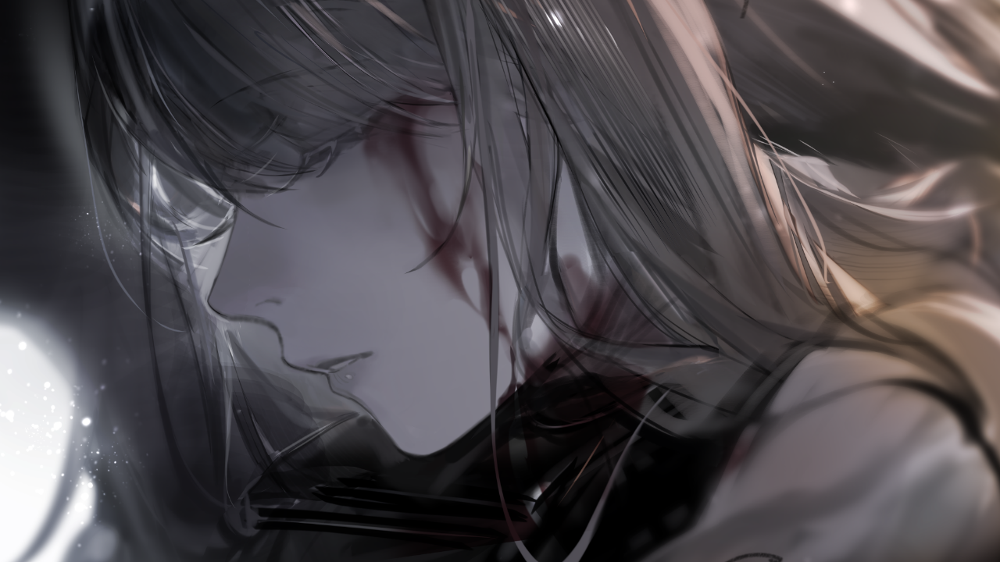
*▲ 官方剧情 CG `Avg_8_7_2`：倒在雪地血泊中的阿丽娜，至死仍紧攥着换粮的空篮，拒绝告诉塔露拉凶手是谁，以免她被仇恨吞噬。*

*▲ 官方剧情 CG `Avg_8_7_3`（《悲伤的火焰》）：塔露拉背着死去的阿丽娜在漫天风雪中独行，失控的火焰将身后的雪原与森林焚烧殆尽。*

2. **黑雪降临：“皇帝的利刃”揭穿身世（`R8-11`）**：
   阿丽娜死后数月，沉浸在巨大悲痛中的塔露拉变得沉默寡言。五名乌萨斯皇家内卫**“皇帝的利刃”**突袭营地，在与塔露拉、爱国者、霜星交战时，故意当众高呼塔露拉为**“科西切公爵之女”**。流言迅速在队伍中发酵，大批感染者因怀疑她是贵族奸细而离队出走。
3. **万劫不复：谷仓惨案与焚村黑化（`JT8-1`）**：
   为了找回失踪数月的感染者牵引车队，塔露拉独自潜入一座三年没有纠察队踏足的无政府村庄，却在空粮仓门板上发现了绝望的抓痕——村民们仅仅为了图省事，将饥饿无力的感染者骗进粮仓活活饿死，再将尸体与废源石一同烧毁。
   面对村民毫无愧疚的狡辩与杀心，塔露拉心中最后一丝对人性的善意彻底泯灭。在喊出**“我恨你们”**的瞬间，熊熊烈火吞噬了整个村庄。当惨叫声平息后，站在火海中的塔露拉看着自己的双手崩溃呢喃（`Avg_8_11`），而在她崩溃的意识深处，“不死的黑蛇”科西切正式接管了这具躯体。

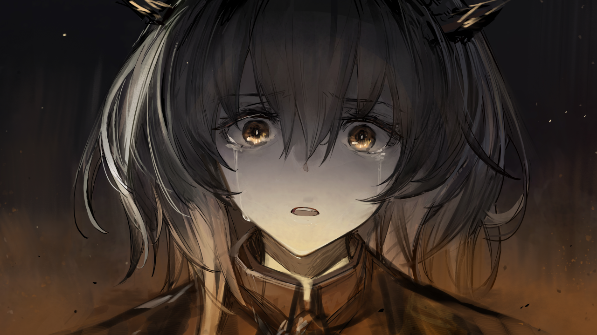
*▲ 官方剧情 CG `Avg_8_11`（《我都做了些什么》）：谷仓惨案后，塔露拉在焚村的熊熊火海中惊恐地看着自己的双手。这是真正的塔露拉沉入意识深渊前的最后一刻。*

---

### 第五幕：切尔诺伯格与龙门事变——暴君的献祭与双龙破局（泰拉历 1096.12—1097.01）
> **对应关卡**：第 0–7 章、`M8-1`–`M8-8`、`JT8-2`、`JT8-3`、`END8-1`

1. **切尔诺伯格暴动与清洗异己（1096年12月—1097年1月）**：
   * 被“黑蛇”主导的“塔露拉”与卡兹戴尔摄政王特雷西斯派出的萨卡兹雇佣兵（W、赫德雷、伊内丝）、乌萨斯第三集团军旧贵族鹰派达成默契，于 1096 年 12 月 23 日天灾前夕发动切尔诺伯格暴动，重创潜入救援博士的罗德岛小队，精英干员 **Ace** 为掩护全队撤退被塔露拉的烈焰焚躯牺牲（`1-8`）。
   * 随后，“塔露拉”故意将整合运动分成两路：将**碎骨（亚历克斯与米莎姐弟）**、**浮士德**、**梅菲斯特**、**弑君者**以及**霜星与雪怪小队**陆续派往龙门送死，借龙门近卫局与罗德岛之手除掉整合运动内部所有真正关心同伴的骨干；同时自己坐镇切尔诺伯格核心城，设计围杀拒不服从的**爱国者**，并启动核心城引擎撞向龙门，企图引爆乌萨斯与大炎的全面战争（`7-1`、`7-8`）。

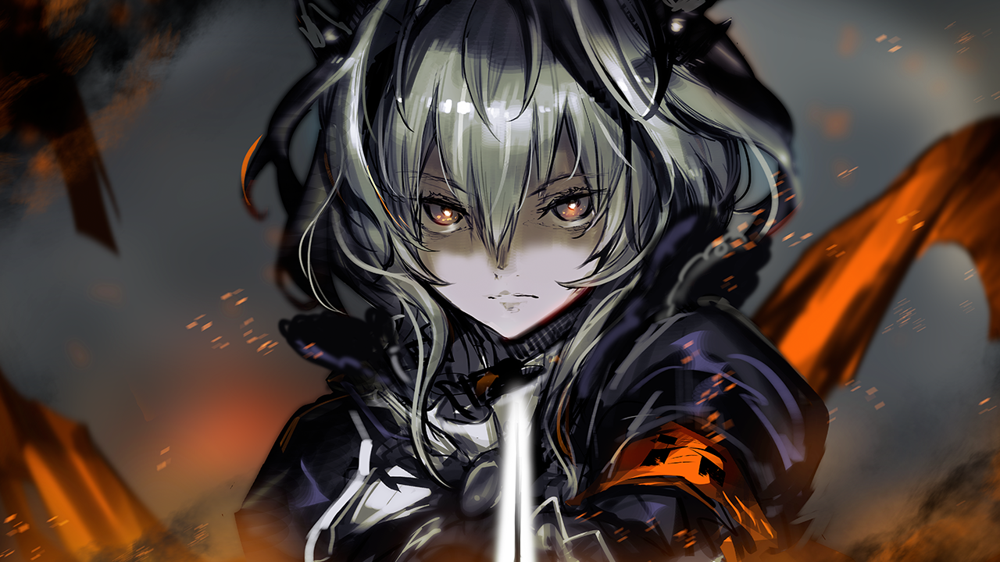
*▲ 官方剧情 CG `Avg_11_1`：在切尔诺伯格废墟与烈焰中挥剑压制全场的整合运动领袖塔露拉。*

2. **指挥塔死斗：赤霄与影霄的共鸣（1097年1月6日，`JT8-2` / `JT8-3`）**：
   * 陈晖洁孤身闯入核心城指挥塔质问塔露拉，阿米娅紧随其后赶到。通过情感与记忆读取，阿米娅揭穿了眼前的“塔露拉”体内盘踞着科西切公爵（“不死的黑蛇”）的真相。
   * 面对自诩为“乌萨斯化身”的黑蛇，阿米娅解开魔王戒指，汲取陈晖洁的剑术记忆与前代萨卡兹魔王奎隆的愤怒之火，幻化出黑剑**“影霄”**，与手持**“赤霄”**的陈晖洁并肩作战！

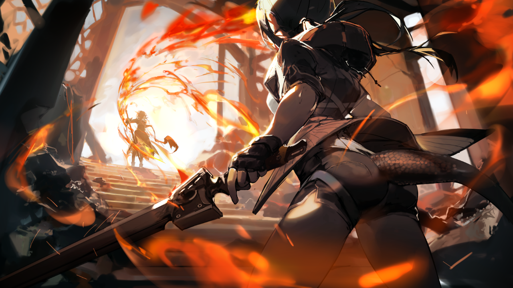
*▲ 官方剧情 CG `Avg_8_40`：指挥塔内，手持赤霄剑的陈晖洁与姐姐塔露拉拔剑相向。*

*▲ 官方剧情 CG `Avg_8_37`：近卫阿米娅（手持影霄）与陈晖洁（手持赤霄）双剑合璧，斩碎“不死的黑蛇”的烈焰屏障。*

3. **横剑拒死与交出真秘钥（`JT8-3`）**：
   * 当赤霄与影霄斩断黑蛇的源石技艺控制链时，走投无路的黑蛇企图利用塔露拉内心深重的负罪感，诱导她横剑自刎（“她心底的绝望，无法摆脱的耻辱，是否足够浓郁到让她想要——自尽？”）。
   * 在阿米娅“哪怕你想要死去，你也得作为塔露拉而死”与陈晖洁的呐喊中，塔露拉猛然夺回身体控制权，向体内的科西切发出决绝宣言：
     > **塔露拉**：“够了。到这里就可以了。我已经不再是你了，科西切。我和你是不同的……我不是另一条黑蛇。……你是种子，你是藤蔓，你是参天大树……没关系，科西切。**我可是火。我的火会把你我一同烧穿。**” —— `JT8-3`
   * 紧接着，当 W 拿着从米莎处得来的假钥匙无法停下核心城时，苏醒的塔露拉从怀中抛出了自己一直暗中保留的**真正制动室秘钥**（她潜意识里最后的良知让她从未销毁这把钥匙），配合口令**“为了喂饱所有人民”**，在下午 5:42 将核心城稳稳停在了龙门舰炮射程之外！

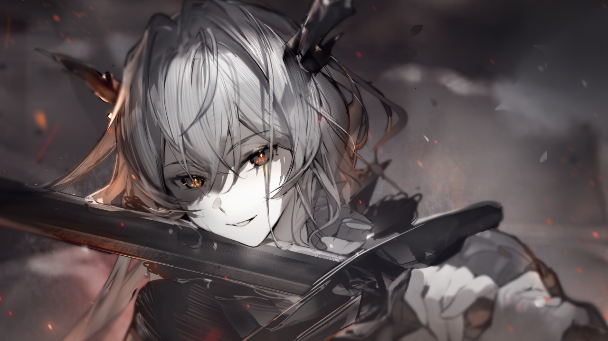
*▲ 官方剧情 CG `Avg_8_12`：黑蛇企图操控塔露拉横剑自刎，塔露拉在阿米娅与陈的呼唤下夺回身体控制权，彻底斩断黑蛇的摆布。*

*▲ 官方剧情 CG `Avg_8_14_2`：一切尘埃落定后，重新找回自我的塔露拉站起身，向妹妹陈晖洁道出那句跨越二十年的“好久不见”。随后姐妹二人丢开刀剑，按儿时魏彦吾教的拳法痛痛快快打了一架。*

4. **政治平衡点与罗德岛收押（`END8-1`）**：
   为了防止乌萨斯第三集团军与龙门将塔露拉灭口或将脏水泼给罗德岛，凯尔希将塔露拉作为制衡双方的关键人证秘密收押于罗德岛本舰。在禁闭室中，面对脑海中科西切残存的幻影，塔露拉平静地回应：**“你带给我的这些丑陋与羞愧……都是我的燃料。我未来的燃料。直到我找到你，直到这片大地都得解放，我不会停止燃烧。”**

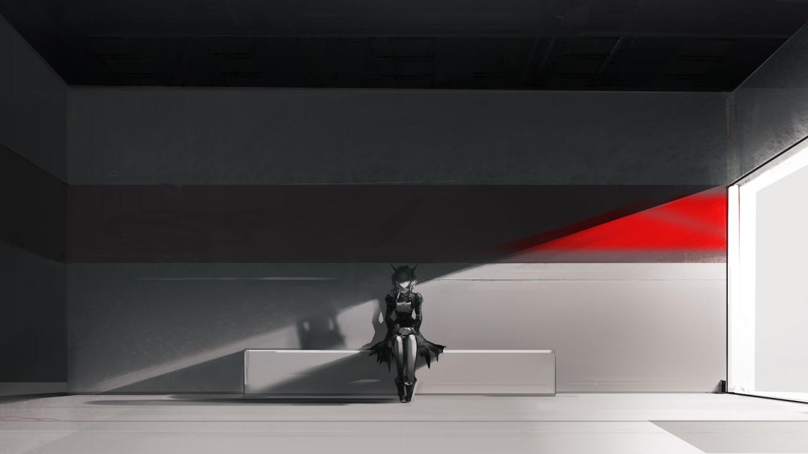
*▲ 官方剧情 CG `Avg_8_19`：被关押在罗德岛特殊禁闭室中的塔露拉，将过去的罪孽与疮疤化作未来抗争的燃料。*

---

### 第六幕：戴镣行者与星火重燃——冻原、维多利亚与远北（泰拉历 1097.09—1100+）
> **对应关卡**：`9-19`、`9-21`、`10-19`、`12-21`、`13-16`、`13-22`、`14-23`、`EG-7（第16章）`、`第17章`

1. **罗德岛劫狱与冻原祭碑（1097年秋，`9-19`–`9-21`）**：
   * 切城事变约十个月后，由前近卫局警官**“九”**、前罗德岛干员 **Guard**、**珀茜瓦尔**与幻影弩手、萨卡兹游击队残部组成的**“新整合运动”**攻入罗德岛本舰劫走塔露拉，目的是“让塔露拉亲自向全体感染者解释并接受审判”。
   * 临走前，塔露拉用火焰逼退 Mon3tr，却刻意控制火苗绕过挡在阿米娅身前的博士，留下祝福：**“你们还会有更长的路要走，但愿……你们的心底没有阴霾。”**
   * 九为塔露拉戴上了限制源石技艺并实时定位的**新镣铐**。在前往维多利亚之前，塔露拉回到乌萨斯北原的旧据点，独自站在爱国者、霜星与阿丽娜粗糙的衣冠冢前良久，轻声立誓：**“看来这里还差一把能让它醒来的火。——我得去将它点起来。”**（`9-21`）。

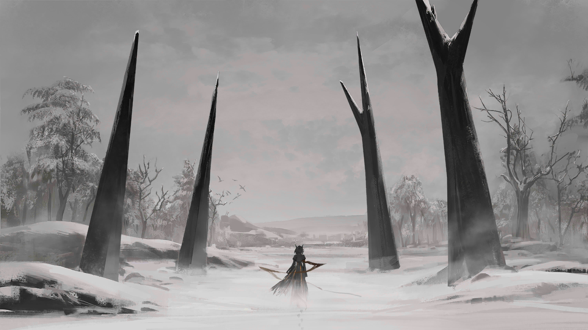
*▲ 官方剧情 CG `21_I13`（`9-21`）：重返乌萨斯冻原、祭拜战友衣冠冢后的塔露拉，在风雪中重新点起篝火。*

2. **大学教室里的交锋：不杀卡谢娜（1098年5月，`10-19`）**：
   凭借十年前蛇鳞密信的地址，塔露拉在乌萨斯北方一座大学城里找到了“不死的黑蛇”的新载体——教授乌萨斯帝国史的骏鹰女教师**卡谢娜（菲奥莉特）**。卡谢娜故意挑衅塔露拉当着学生的面烧死自己，但历经沉淀的塔露拉看穿了黑蛇的本质，收回了杀意：
   > **塔露拉**：“我不信。但我也不再是那个以为杀了她就能解决问题的塔露拉。……不死的恶神……终将死去。可杀死她的，不会是我。**——乌萨斯会杀死她。终有一天，觉醒的人们会将愚昧的统治者狠狠地抛下。在那之后，乌萨斯将再无黑蛇。**” —— `10-19`

3. **远征维多利亚：芦苇荡斥退爱布拉娜与街头重逢（1098年秋冬，第12–14章）**：
   * 塔露拉作为戴铐的阶下囚随新整合运动进入伦蒂尼姆周边，救助被天灾与萨卡兹战争波及的底层感染者市民，并在 `13-16` 见证了 Guard 为掩护平民撤离而壮烈牺牲。
   * 在 `13-22` 的芦苇沼泽中，同为德拉克王室血脉的“深池”领袖**爱布拉娜**用死灵紫火包围了整合运动，招揽塔露拉共享维多利亚王权。九解开塔露拉的镣铐，塔露拉以澎湃的橙红烈焰正面击碎紫火，冷酷地批驳爱布拉娜：**“我对德拉克的血统没有兴趣，对权力和国家都没有兴趣。……无论你怎么高谈阔论，你都只是个虚伪的暴君。死亡只是你的权杖，而我见过了暴君。从整合运动面前滚开。”**
   * 在 `14-23` 中，塔露拉与九在伦蒂尼姆城内轰塌奸商囤积防护服的仓库高墙，挽救了大批濒死感染者，并在火光中与妹妹陈晖洁遥遥相望。

*▲ 官方剧情 CG `43_i03`（`13-22`）：伦蒂尼姆城外，塔露拉的赤红烈焰与深池领袖爱布拉娜的死灵紫火正面碰撞。*

4. **乌萨斯边境麦田与重返远北（1099—1100+，第16章 `EG-7` 至第17章）**：
   * 离开维多利亚后，塔露拉随新整合运动在乌萨斯与卡西米尔交界的争议荒原扎根了整整两年。她洗去铅华，在田间帮农妇拔除麦田杂草，看着感染者农庄建起抑制剂流水线。
   * 面对历经天灾与苦难却依然对整合运动报以真诚信任的普通农妇，塔露拉终于彻底治愈了当年“谷仓惨案”留下的创伤，对九说出了她人生哲学的最终升华：
     > **塔露拉**：“当活着的苦痛已经无数次压垮过这些人之后，他们贫瘠的土地上竟然还能捧出这样比黄金更宝贵的情感？……所以，我开始思考……如果这就是事物发展的规律呢？这些最质朴的人们所相信的真理，也不过如此。**跌倒，而后重新站起；失败，而后从头再来。我们还会失败，九。但我认为，现在我们已经能够不为此感到忧惧。**” —— `EG-7`
   * 就在此时，从消息封锁的**乌萨斯“远北”矿区**逃出大屠杀的感染者矿工寻着“整合运动”的名字赶来求援。塔露拉与九率领成熟的整合运动再度北上，在远北封闭区（第17章）与再度现身煽动极端弱肉强食革命的**卡谢娜（黑蛇）**展开了关于乌萨斯未来的全新较量。

*▲ 官方剧情 CG `66_i19`（第16章 `EG-7`）：在乌萨斯边境的金黄麦田中，与农妇和平民一同劳作的塔露拉与九，迎来了整合运动真正扎根大地的黎明。*

---

## 第五章：泰拉历完整时间线与原典语录汇编

### 5.1 塔露拉生平与整合运动演进全时间表（泰拉历 1055—1100+）

| 泰拉历年份 | 塔露拉年龄 | 核心历史事件 | 发生地点 | 官方出处关卡 / 文献 |
| :--- | :--- | :--- | :--- | :--- |
| **约 1055 年** | *出生前13年* | 生父爱德华·雅特利亚斯携“诸王之息”钥匙逃离维多利亚，抵达龙门，与魏彦吾、林舸瑞结义，合力将科西切驱逐出龙门。 | 维多利亚 $\rightarrow$ 龙门 | `END8-1`、`13-9`、《大地巡旅》 |
| **1067 年** | *出生前1年* | 科西切向大炎皇室与伦蒂尼姆泄露爱德华与魏彦吾胞妹秘婚之事；魏彦吾被迫以赤霄剑斩杀义弟爱德华，密不发丧十年。 | 龙门 | `7-20`、`END8-1` |
| **1068 年 1 月 9 日** | **0 岁** | **塔露拉作为遗腹子在龙门出生**；母亲被迫改嫁陈氏贵族（后生下陈晖洁），在痛恨与抑郁中早逝。 | 龙门 | 《切城-龙门事件调查报告》 |
| **1068—1077 年** | **0—9 岁** | 龙门童年岁月：在流言中保护妹妹陈晖洁，在学校为保护幼年诗怀雅而打架，与陈晖洁建立深厚手足羁绊。 | 龙门 | `7-19`、`JT8-3` |
| **1077 年** | **9 岁** | **“白昼夺女”事件**：科西切潜入龙门，给塔露拉戴上可引爆半座城区的源石炸弹铐环；为救龙门与魏彦吾，塔露拉随科西切前往乌萨斯。 | 龙门 $\rightarrow$ 乌萨斯 | `7-20`、`M8-2` |
| **1077—1086 年** | **9—18 岁** | 在科西切公爵领作为继承人接受教育，多次暗中修改法令保护感染者，与科西切展开长达九年的意识形态交锋。 | 乌萨斯 · 科西切领 | `7-3`、`R8-5` |
| **1086 年春** | **18 岁** | 为粉碎科西切的继承与联姻计划，**塔露拉将源石碎片亲手嵌进左臂，主动感染矿石病**。 | 乌萨斯 · 科西切领 | `R8-5（行动后）` |
| **1086 年秋/冬** | **18 岁** | **刺杀科西切**：因放走安东尼奥少校之子与科西切决裂，在王座厅一剑刺穿科西切胸膛；科西切临死前种下“不死的黑蛇”赌约。 | 乌萨斯 · 科西切领 | `R8-5（行动后）` |
| **1087—1089 年** | **19—21 岁** | 逃亡至乌萨斯西北冻原，被老农**伊万·伊贾斯拉夫夫妇**收留，结识埃拉菲亚乡村教师**阿丽娜**，隐居务农两年。 | 乌萨斯西北冻原 | `R8-1` |
| **1089 年 12 月 14 日** | **21 岁** | 脱离黑蛇第三年冬：感染者纠察队进村例行检查并打伤伊万老爹，塔露拉出手击退纠察队员。 | 西北冻原小村庄 | `R8-1` |
| **1090 年 1 月 13 日** | **22 岁** | **芦苇荡之火**：纠察队大举搜村，伊万老爹割腕释放法术替塔露拉顶罪惨死；塔露拉怒极焚灭纠察队，携阿丽娜踏上流亡之路。 | 西北冻原小村庄 | `R8-3` |
| **1090 年 2 月 7 日** | **22 岁** | 在冻原解救被纠察队屠杀的感染者聚落，立下“重拾面包与火”的誓言，创立早期感染者自救团体。 | 西北冻原 | `R8-4` |
| **1091 年** | **23 岁** | **整合运动正式成型**：击败雪怪小队队长**霜星**，说服**爱国者**率游击队合流；在森林中救下感染者少年**萨沙（浮士德）**与**伊诺（梅菲斯特）**。 | 西北冻原矿场 | `R8-5`、`R8-6` |
| **约 1094—1095 年** | **26—27 岁** | **卷耳村背叛事件**：获准离队的感染者占据移动地块并向乌萨斯军告密出卖整合运动；塔露拉坚持不杀逃兵，赢得爱国者彻底敬重。 | 冻原南缘 | `R8-8`、`EG-1` |
| **约 1095 年 12 月 7 日** | **27 岁** | **悲剧转折一（阿丽娜之死）**：外出换粮的阿丽娜惨遭杀害，在塔露拉背上流尽鲜血逝世，临终叮嘱她“绝不可去恨一个人”。 | 冻原森林 | `R8-9` |
| **约 1096 年 2 月 21 日** | **28 岁** | **悲剧转折二（内卫揭底）**：五名乌萨斯“皇帝的利刃”突袭，当众揭穿塔露拉“科西切之女”身份；爱国者力保塔露拉，但内部猜忌蔓延。 | 冻原与城市交界 | `R8-11` |
| **约 1096 年春/夏** | **28 岁** | **悲剧转折三（谷仓惨案与黑蛇夺舍）**：发现无政府村庄的村民自发将饥饿感染者锁入空粮仓活活饿死并焚尸；塔露拉信念崩塌焚毁全村，“不死的黑蛇”接管意识。 | 乌萨斯荒僻村庄 | `JT8-1` |
| **1096 年 12 月 23 日** | **28 岁** | **切尔诺伯格事变爆发**：黑蛇塔露拉率异化后的整合运动及萨卡兹雇佣兵攻陷切尔诺伯格，击杀罗德岛精英干员 Ace。 | 切尔诺伯格 | 第 0–1 章 |
| **1097 年 1 月 6 日** | **28 岁** | **核心城决战**：霜星、浮士德、爱国者相继战死；陈晖洁与近卫阿米娅攻入指挥塔斩断黑蛇控制；塔露拉清醒并交出真秘钥于 17:42 停下核心城，战后被罗德岛收押。 | 切城核心城 / 龙门外围 | 第 6–8 章（`JT8-2`–`END8-1`） |
| **1097 年秋/冬** | **29 岁** | **罗德岛劫狱与冻原祭碑**：“九”与 Guard 率新整合运动劫走塔露拉；塔露拉戴上镣铐重返冻原祭拜战友衣冠冢，决定重燃星火。 | 罗德岛本舰 $\rightarrow$ 冻原 | `9-19`、`9-21` |
| **1098 年 5 月** | **30 岁** | **大学教室交锋**：在北方大学找到黑蛇新容器**卡谢娜**，看穿黑蛇本质后放弃暗杀，断言觉醒的乌萨斯人民终将彻底终结黑蛇。 | 乌萨斯北方大学城 | `10-19` |
| **1098 年秋—冬** | **30 岁** | **维多利亚伦蒂尼姆篇**：随新整合运动救助伦蒂尼姆感染者；在芦苇荡以红龙烈焰击退深池领袖**爱布拉娜**；推倒奸商仓库高墙并与陈晖洁重逢。 | 伦蒂尼姆及周边 | `12-21`、`13-22`、`14-23` |
| **1100 年前后** | **约 32 岁** | **边境务农与重返远北**：在乌萨斯-卡西米尔边境农庄耕作两年，领悟“跌倒再站起”的韧性真理；接纳远北矿区屠杀幸存者，再度率军深入乌萨斯远北直面卡谢娜。 | 乌萨斯边境 $\rightarrow$ 远北矿区 | 第16章 `EG-7`、第17章 |

---

## 附录：如何阅读本目录下的图文 PDF 手册

本文件夹（`e:\Antigravity\一些想法\塔露拉\`）下已为您完整生成以下文件：
1. **`01_内容框架与考据方法论.md`**：前期调研报告、海外考据方法论拆解与大纲。
2. **`02_塔露拉人物设定与剧情全考据.md`**：即本文档，包含完整文字考据、Mermaid 关系图与时间表。
3. **`塔露拉_官方世界观手册风格全考据档案.pdf`**：参照《明日方舟：大地巡旅》与罗德岛机密档案排版风格制作的**图文并茂高清 PDF 手册**，内嵌全部 25+ 幅官方原画 CG、多时期立绘对比、定制矢量人物关系图、心理崩塌与双线叙事脉络图以及跨页编年史时间轴。
4. **`assets/`**：从官方图床与 Wiki 提取的全部无损官方角色立绘与剧情插画（CG）原始图片库（绝无任何 AI 生成图片）。
