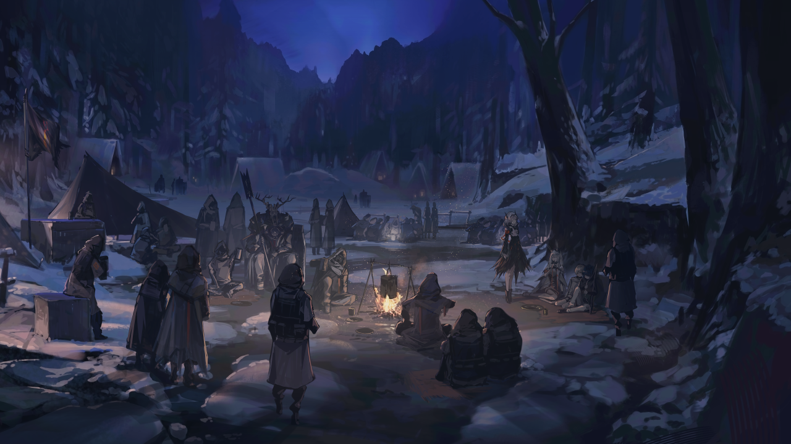
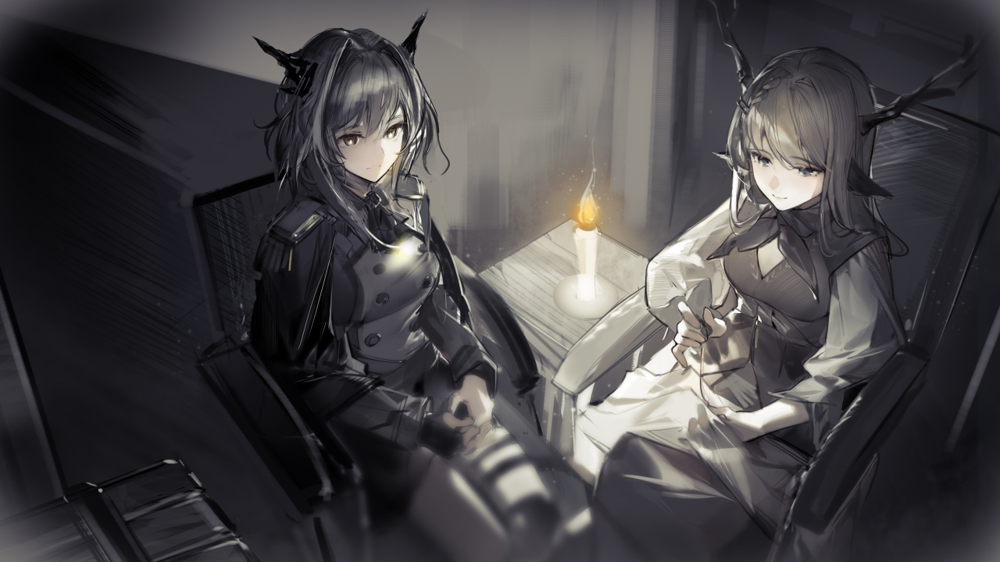
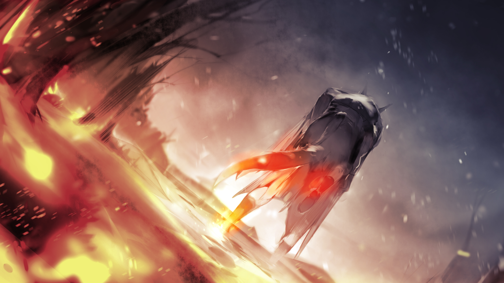
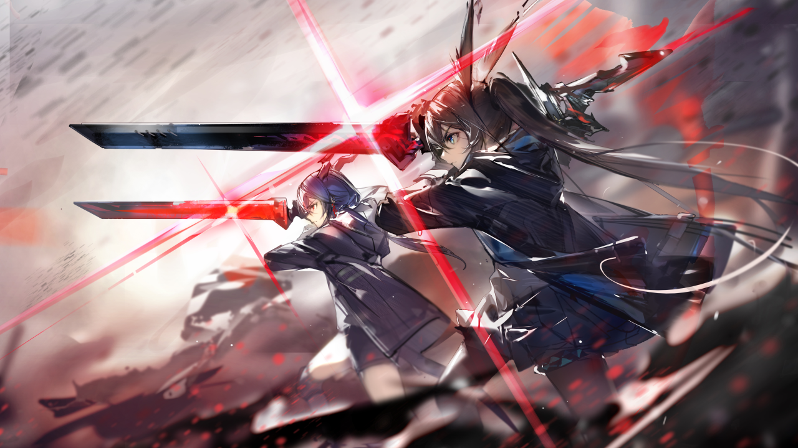
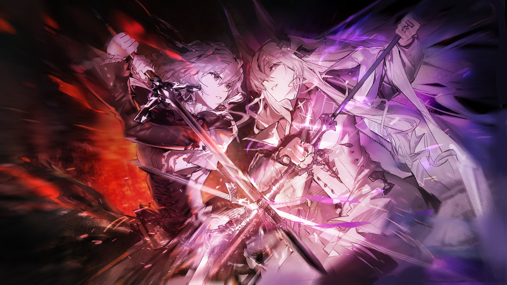
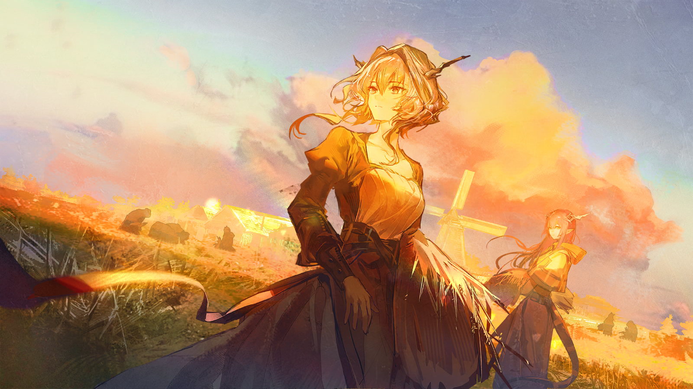

# 《明日方舟》塔露拉·雅特利亚斯（Talulah Artorius）全考据档案与官方世界观设定集手册

> **FILE NO.** `RI-TLL-1068-1100` ｜ **设计范式**：《明日方舟官方世界观设定集：大地巡旅》(Terra: A Journey) 机密卷宗风格  
> **联合创作**：[@CwC-HydeX](https://github.com/CwC-HydeX) × **Google (Google DeepMind / Google Gemini 4 Argon)**  
> **覆盖剧情跨度**：泰拉历 1055 年 — 1100+ 年（主线第 0 章至第 17 章《离解复合》全剧情闭环）  
> **图像与文本准则**：100% 采用鹰角网络（Hypergryph）官方游戏原画立绘与剧情插画（CG），所有剧本引文均逐字提取自官方简体中文剧本并精确标注关卡编号。

---

## 📁 仓库文件总览与各文件说明（File Guide）

本仓库收录了关于《明日方舟》核心人物**塔露拉·雅特利亚斯**的完整考据研究报告、Markdown 源码、网页排版源码（HTML）以及可直接阅读/打印的高清排版设定集（PDF）。

为了方便不同阅读偏好的读者，本仓库同时提供**【原版（19页舒展版）】**与**【剧情详述增强版（21页精讲版）】**两个版本。各文件的具体用途与区别如下表所示：

| 文件 / 文件夹名称 | 文件类型 | 大小 / 规格 | 文件内容与用途详细说明（备注） |
| :--- | :---: | :---: | :--- |
| 📄 **[`README.md`](./README.md)** | Markdown | ~6 KB | **仓库导读总览与全文件目录说明**：介绍项目背景、各文件功能区别、版本选择建议及章节大纲。 |
| 📕 **[`塔露拉_官方世界观手册风格全考据档案_剧情详述增强版.pdf`](./塔露拉_官方世界观手册风格全考据档案_剧情详述增强版.pdf)** | **高清 PDF** *(最推荐)* | 41.0 MB （共 21 页） | **【V2 剧情详述增强版 · 设定集 PDF】** 在保留前四章全部考据的基础上，**大幅扩充了第五章（第 11–21 页）每组官方剧情 CG 之间的故事背景、关卡前因后果、人物心理博弈与剧本原话**（涵盖伊万老爹割腕顶罪、卷耳村背叛、谷仓惨案门板抓痕、双剑合璧与交出核心城真秘钥、北方大学不杀卡谢娜、伦蒂尼姆双龙对决及边境麦田拔草等完整细节）。图片已 100% 内嵌，可单文件独立分享阅读。 |
| 📘 **[`塔露拉_官方世界观手册风格全考据档案.pdf`](./塔露拉_官方世界观手册风格全考据档案.pdf)** | **高清 PDF** | 40.7 MB （共 19 页） | **【V1 舒展标准版 · 设定集 PDF】** 采用 10.5pt 舒适正文字号与未裁切完整比例官方 CG 排版的 19 页标准版手册。第五章以凝练的阶段导读串联 18 幅核心剧情 CG，适合喜欢紧凑阅读节奏的读者。图片已 100% 内嵌。 |
| 🌐 **[`塔露拉_官方世界观手册风格全考据档案_剧情详述增强版.html`](./塔露拉_官方世界观手册风格全考据档案_剧情详述增强版.html)** | HTML 源码 | ~121 KB | **【V2 剧情详述增强版 · 网页排版源码】** 对应 21 页增强版 PDF 的 HTML5 + CSS3 排版源文件（含内联矢量 SVG 人物关系拓扑图与三阶段心理防线崩塌图）。图片通过 `./assets/` 相对路径引用同目录高清原图，支持用浏览器直接打开阅读或二次编辑。 |
| 🌐 **[`塔露拉_官方世界观手册风格全考据档案.html`](./塔露拉_官方世界观手册风格全考据档案.html)** | HTML 源码 | ~100 KB | **【V1 舒展标准版 · 网页排版源码】** 对应 19 页标准版 PDF 的 HTML5 + CSS3 排版源文件，同样引用 `./assets/` 本地图片库。 |
| 📝 **[`02_塔露拉人物设定与剧情全考据_剧情详述增强版.md`](./02_塔露拉人物设定与剧情全考据_剧情详述增强版.md)** | Markdown | ~65 KB | **【V2 剧情详述增强版 · 纯文本与 Mermaid 考据全集】** 适合在 GitHub 网页端或 Markdown 编辑器（如 Obsidian / Typora）中直接阅读的完整考据文档。包含基础档案表、Mermaid 关系拓扑图、四层“黑蛇”机制剖析、**图文穿插精讲版六阶段剧情全纪实**及泰拉历 1055–1100+ 完整编年史表。 |
| 📝 **[`02_塔露拉人物设定与剧情全考据.md`](./02_塔露拉人物设定与剧情全考据.md)** | Markdown | ~55 KB | **【V1 标准版 · 纯文本与 Mermaid 考据全集】** 原版 Markdown 深度考据文档，包含完整的人物背景、性格动机拆解、六幕编年史及原典语录。 |
| 📋 **[`01_内容框架与考据方法论.md`](./01_内容框架与考据方法论.md)** | Markdown | ~11 KB | **【前期调研报告与海外考据方法论】** 拆解国内外《明日方舟》社区（PRTS Wiki、森空岛、Reddit `r/arknights`、YouTube 剧情解析与《大地巡旅》官方设定集）的人物考据框架，说明本档案采用的结构设计与四大镜像角色对照法（Foil Analysis）。 |
| 🖼️ **[`assets/`](./assets/)** | 图像资源库 | 37 个文件 (~54 MB) | **【官方无损原画立绘与剧情插画（CG）图库】** 从官方游戏资源与 PRTS Wiki 提取的 37 张高清原画素材（绝无任何 AI 生成图），涵盖塔露拉四阶段立绘、陈/阿米娅/爱国者/霜星/阿丽娜/爱布拉娜等角色立绘，以及主线第 0–17 章全部关键剧情 CG，供 HTML 与 Markdown 渲染调用。 |

---

## 📖 档案核心章节架构（Chapter Outline）

无论您阅读 PDF 设定集还是 Markdown 文档，全卷宗均遵循**“从人物定位 $\rightarrow$ 血脉身世 $\rightarrow$ 关系网络 $\rightarrow$ 心理崩塌机制 $\rightarrow$ 全剧本图文纪实”**的五步递进结构，即使从未接触过《明日方舟》也能无障碍读懂：

1. **卷首总览（COVER & OVERVIEW）**：塔露拉核心人事档案卡（红龙德拉克与炎国真龙混血、身高、源石技艺）与四阶段形象演变（1086 科西切领的公爵养女 $\rightarrow$ 1089 冻原燃火者 $\rightarrow$ 1096 切城黑蛇暴君 $\rightarrow$ 1100 麦田与北原的新生行者）。
2. **第一章：双龙血脉与失落童年（1055—1077）**：父辈龙门结义与大炎皇室逼迫下的“挥泪斩义弟”（爱德华之死）、塔露拉与妹妹陈晖洁的童年羁绊，以及 1077 年科西切公爵震动龙门的“白昼夺女”事件。
3. **第二章：人物关系全图谱与四大叙事镜像（1077—1100）**：
   * 定制高分辨率矢量关系拓扑图（横跨龙门血亲、早期整合运动、黑蛇宿敌、罗德岛与维多利亚深池）。
   * **四大镜像人物（Foil Characters）对照矩阵**：阿丽娜（针线 vs. 刀剑）、陈晖洁（体制律法 vs. 旷野革命）、阿米娅（分担重负的同行者 vs. 孤身硬扛的殉道者）、爱布拉娜（奴役死者的紫火暴君 vs. 守护生者的橙红薪火）。
4. **第三章：心理演变与“不死的黑蛇”夺舍机制深度剖析**：
   * 深度拆解“不死的黑蛇”并非低级的提线木偶魔法，而是建立在**“一旦塔露拉对受苦大众产生恨意并认同科西切，精神寄生即刻生效”**之上的意识形态诅咒。
   * 复盘 1095–1096 年击碎塔露拉心理防线的**“三记致命重锤”**：① 阿丽娜惨遭杀害（斩断精神刹车） $\rightarrow$ ② 乌萨斯内卫“皇帝的利刃”当众揭穿科西切养女身世（瓦解组织信任） $\rightarrow$ ③ 无政府村庄“谷仓惨案”门板内侧的绝望抓痕（击碎人性幻想）。
5. **第四章：泰拉历 1068—1100+ 塔露拉人生轨迹与历史坐标全表**：双栏精确到月日的泰拉历史年表。
6. **第五章：游戏剧情完整经历全纪实（第 0—17 章 18 幅核心官方 CG 全串联）**：
   * **第一阶段（1087–1095）**：伊万老爹割腕顶罪、冰雪对决霜星、感召爱国者、收留萨沙与伊诺、黄金时代篝火与卷耳村背叛。
   * **第二阶段（1095–1096）**：风雪背负阿丽娜遗体、内卫诛心揭底、谷仓惨案焚村与黑蛇夺舍。
   * **第三阶段（1096.12–1097.01）**：切尔诺伯格暴动、借刀清洗异己（碎骨/浮士德/霜星/爱国者之死）、核心塔赤霄与影霄双剑合璧、横剑拒死并交出核心城真制动秘钥。
   * **第四阶段（1097–1098.05）**：罗德岛禁闭室思辨、“九”率新整合运动劫狱、冻原祭拜战友衣冠冢、北方大学教室看穿黑蛇本质不杀卡谢娜。
   * **第五阶段（1098 秋–冬）**：远征维多利亚伦蒂尼姆、芦苇沼泽橙红生命之火击碎爱布拉娜死灵紫火（《13-22 双龙》）。
   * **第六阶段（1099–1100+）**：乌萨斯边境金黄麦田拔草劳作（《EG-7》完成谷仓惨案救赎闭环）、接纳远北矿区屠杀幸存者并重返极北冻原（第 17 章《离解复合》）。

---

## 🖼️ 核心官方剧情插画（CG）预览

| 树影下的依靠 (`R8-6`) | 悲伤的火焰 (`R8-9`) |
| :---: | :---: |
|  |  |
| **赤霄与影霄双剑合璧 (`JT8-3`)** | **跨越二十年的“好久不见” (`JT8-3`)** |
|  |  |
| **伦蒂尼姆红龙双生之战 (`13-22`)** | **麦田里的新生 (`第16章 EG-7`)** |
|  |  |

---

## 📌 版权、联合创作与致谢声明（Contributors & Credits）

* **项目策划、统筹与主编**：[@CwC-HydeX](https://github.com/CwC-HydeX)
* **联合文献考据、剧本精析与《大地巡旅》版式排版**：**Google (Google DeepMind / Google Gemini 4 Argon)**
* **技术支持与智能体协作**：Google Antigravity
* 本档案中引用的所有《明日方舟》(Arknights) 角色设定、剧本台词、世界观名词及 `./assets/` 目录下的官方立绘与剧情插画（CG），其著作权均归属 **上海鹰角网络科技有限公司（Hypergryph）** 所有。
* 资料整理与图像检索参考自 [PRTS Wiki](https://prts.wiki/)、《明日方舟官方世界观设定集：大地巡旅》及《罗德岛切尔诺伯格—龙门事变调查报告》，仅供剧情研究、设定考据与非商业学习交流使用。
